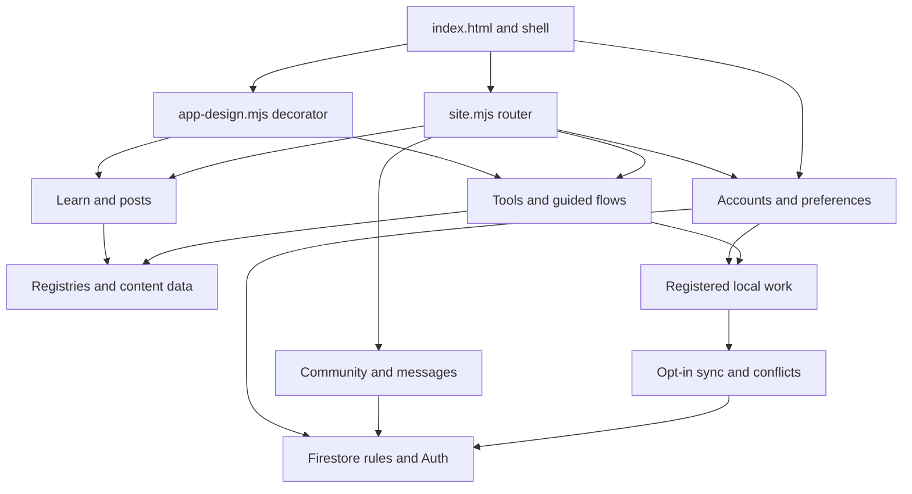
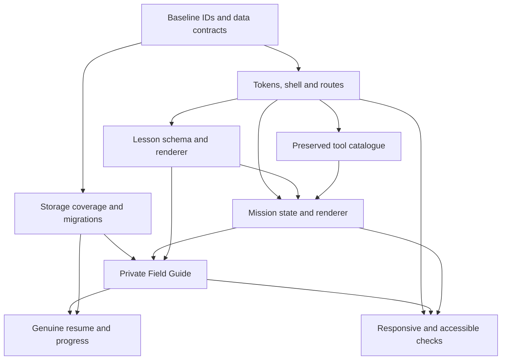

# Implementation dependency map

This is a plan, not implemented functionality. Baseline: `a05d5b656a539360345c470b723776970adfe2ff`. Written stage order remains authoritative. Only Stage 0 has been executed.

## Current application dependencies

The graph shows ownership boundaries, not every import. The full directed module graph is `inventory.json → imports`. In particular, many imports are eager, while the current global decorator modifies outputs after page render. Split render ownership carefully before consolidating CSS.

## Foundations needed by the new experiences

Lesson and mission schemas can share UI primitives without sharing identical pedagogical state. A tool remains independently usable whether or not a mission links to it. A Field Guide entry remains user-editable and contextual, rather than becoming an automatic summary of a questionnaire.

## Route contract before visual migration

| Contract | Requirement |
|---|---|
| Canonical primary destinations | `#home`, `#lab`, `#learn`, `#tools`, `#account`; visual label You, not a forced route rename |
| Legacy aliases | Preserve `#help`, `#navigate`, `#library/<shelf>`, `#blog`, `#writing`, `#watch`, `#maps`, `#tool/maps`, and existing guided/tool/play/post links |
| Nested paths | Parse all segments for `#lab/mission/<id>`, `#learn/lesson/<id>`, `#guide/<category>`; validate unknown or malformed IDs and decode safely |
| Current planned paths | `#tools/<theme>` needs actual filter state; current handler ignores the suffix. Existing `#learn/<shelf>` is functional and must continue working |
| Navigation state | Central mapping from route to primary destination; discussion/messages/account map to You, old tool paths to Tools, editorial to Learn |
| Back and reload | Keep path/query/filter semantics; restore list state and focus; distinguish stepping back within an exercise from exiting it |
| Render lifecycle | Each route returns cleanup for timers, listeners, audio, observer work and iframe ownership; don’t leave behavior attached to a removed screen |
| Support | Persistent header link and existing dialog behavior; urgent support never depends on lessons, progress or sign-in |
| Not-yet-built destinations | Honest unavailable state with working return/navigation; no imitation completion screen or nonfunctional primary CTA |

## Preservation fix before adding storage

Do not rename all keys or automatically import old data. First add fixtures for guest, two account UIDs, shared-device sessions, locked work, invalid JSON, offline pending changes, conflicts and deletion. Address the active mixer v2 and saved Big Five atlas gaps, and the SimplyFocus-to-Lifestyle task transfer gap. Align any new registered key with the local registry, exports, deletion and Firestore allowlist together.

Unscoped legacy data has no reliable account owner. The eventual migration should show what was found, allow explicit selection/import, preserve the original until a verified copy exists, and be idempotent. Cloud upload stays a separate opt-in. If this repair is taken alongside Stage 1, keep it in a separate preservation commit with its own tests; it does not authorize Stage 6’s new Guide.

New lesson/mission records need versioned IDs and a minimal state contract: selected choices, current step, explicit completion, timestamps only when actually recorded, and content version. Do not persist free text or sensitive derived interpretations merely to render progress. Field Guide requires its own versioned schema from the brief, four collections, editable confidence tags, context and source references; maps remain maps.

## Stages, proposed commits and exit criteria

| Stage | Proposed changes | Dependencies | Demonstrable exit criteria |
|---|---|---|---|
| **0 — audit** | `docs: record source inventory and baseline evidence` | Current main + complete handoff | Inventory, hashes, preservation matrix, dependency map, actual test logs and 390/1440 captures; remote branch limitation explicit |
| **1 — shell** | `refactor: define route compatibility and lifecycle`; `feat: add shared tokens and five-destination shell`; `test: protect navigation and preferences` | Stage 0; exact existing route IDs | Single row at 320/360/390/430/768/900, desktop rail at 1280/1440; correct active state, Back/reload/focus, safe area; legacy tools and guest/account preferences unchanged; before/after captures |
| **2 — Home** | `feat: simplify Home and re-present existing wizard`; `test: preserve recommendation and draft routes` | Stage 1; existing recommendation logic | One CTA + Practise/Learn; no invented resume; three wizard steps and correct real recommendation; all situations/subparts still reachable; desktop composition verified |
| **3 — Tools** | `feat: add compact tool discovery and metadata`; `test: lock catalogue IDs and deep links` | Stage 1 shell, Stage 2 route flows | All 103 baseline entries retained, seven compact themes, search/A–Z/time/format/pins/recent work; no blank subcollection; metadata unknowns labeled rather than guessed |
| **4 — Learn** | `feat: add lesson schema and one reviewed active lesson`; `test: gate content and permitted progress` | Shell, publication schema and account tracking preferences | All existing shelves/post IDs preserved; available vs planned unambiguous; one complete 3–5-minute demonstration with practice, feedback and transfer; honest empty state for absent media |
| **5 — Life Lab** | `feat: add five worlds and mission engine`; `feat: complete Forest Reality Sorter`; `test: cover mission navigation and accessibility` | Shell, interaction primitives, reviewed content, storage contract if persisting | One end-to-end sorter/alternatives/evidence/test/review experience; meaningful unknown, back/skip/exit, tap+keyboard; reload/back real; three entry points per world with unbuilt ones labeled honestly |
| **6 — Field Guide** | `feat: add private Guide collections and records`; `test: prove migration and opt-in sync` | Storage coverage repair, Lab results, account exports/rules | Four collections; create/edit/delete/export; explicit save; observation/hypothesis/helped-before tags; local default, real sync consent; old maps/drafts/bookmarks intact |
| **7 — integration** | `refactor: migrate remaining renderer wrappers in small groups` | Shared components, catalogue and data regression gates | SimplyFocus, Stim, questionnaires, custom tools, account, community, messages, Wisbody and support visually coherent; meaningful empty/error/guest/locked states; no capability removal |
| **8 — release** | `perf: optimise artwork and offline delivery`; `test: complete accessibility and release gates` | All prior stages | Keyboard/screen reader, 200%/400% zoom, low-stim, contrast, 320px, actual devices, install/offline, live test-account operations, routes, CI, rollback and screenshots; residual limitations documented |

Do not use Stage 8 as an excuse to postpone basic accessibility or testing. Each stage tests its own behavior and preservation boundaries. Optional advanced rewards or additional content remain outside these gates until their stage and actual data support them.

## Design implementation contract

Use the Master Brief’s exact token values as the initial source: forest green `#2B5745`, ink `#203C32`, paper `#FFFCF4`, background `#F1F3EB`, sage, peach, lavender, sand and sky surfaces. Check rendered contrast before final use. Keep a characterful serif for major headings and modern sans-serif for controls and body. Mobile body text should be approximately 16px or larger; major controls approximately 44–52px. Illustrations support one clear action and stay below roughly 40% of Home’s first viewport.

Implement AppShell/TopBar/BottomNav/DesktopRail/ScreenHeader first. Then ChoiceGrid, ProgressStepper, ToolRow, EmptyState and AccessibleDialog. Lesson/Mission mechanics add EvidenceSorter, AlternativeCard and ExperimentRecorder. FieldGuideEntry and SaveToGuideSheet arrive with actual persistence. Component names describe responsibilities; they do not require a particular framework.

Use existing transparent mascot poses and landscape art first. Build an asset manifest tying each pose/scene to a screen purpose, responsive sizes and low-stim alternative. Do not crop raster text from a board, invent a second mascot style or render a large character beside every tool row. Dedicated Meadow, Forest, Bridge, Workshop and Observatory compositions should follow the concept boards closely; any absent crop is a production asset task, not a reason to substitute generic gradients.

## Reversible delivery

Keep one stage per reviewable branch/commit group and record the baseline SHA. Preserve old DOM contracts until consumers migrate. Leave original keys intact through verified migrations. Rollback of UI files should not require reversing user data; schema readers must tolerate old and new versions. A service-worker release needs an explicit cache-version/update decision and a tested rollback path. Never claim “all tests pass” by excluding a failing baseline test without documenting and resolving the expectation.

No stage past 0 has been implemented by this package.
